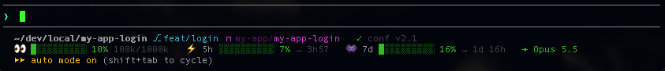
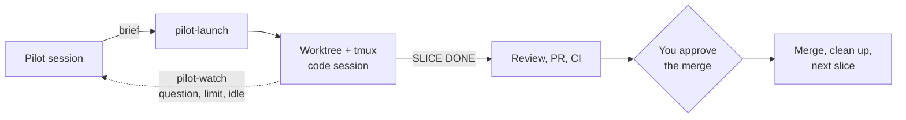

<div align="center">

# cc-global-setup

**Delegate real work to Claude Code. Keep the final say.**

A user-scope plugin that gives every project the same safety rails, the same structure,
and a way to run parallel Claude sessions without losing control of what reaches `main`.

[](https://github.com/mriusero/cc-global-setup/actions/workflows/test.yml)
[](https://code.claude.com/docs/en/plugins)
[](CHANGELOG.md)
[](#principles)
[](#requirements)
[](LICENSE)

[Install](#install) · [Features](#features) · [Configuration](#configuration) · [Pilot](#pilot) · [Principles](#principles) · [Versioning](#versioning)



</div>

---

<a id="why"></a>
## Why

Claude Code is fast enough to write most of your code. The hard part is everything around it:
making sure nothing gets pushed, merged or deleted behind your back, keeping every repository
configured the same way, and running several sessions at once without them stepping on each other.

`cc-global-setup` packages the setup I use daily across all my projects. Install it once at
user scope, switch off what you don't need, and every repository gets it.

<a id="install"></a>
## Install

```text
/plugin marketplace add mriusero/cc-global-setup
/plugin install cc-global-setup@cc-global-setup
/cc-global-setup:setup-statusline
```

Claude Code asks for your preferences when the plugin is enabled. You can change them later
in `/config`.

Plugins can't register Claude Code's status line on their own: the last command copies the
script to `~/.claude/statusline.sh` and adds it to your settings. Run it again after an update.

<a id="features"></a>
## Features

<table>
<tr>
<td width="50%" valign="top">

### 🛡️ Git guard
Claude **asks before** `git push`, `git merge`, `gh pr create` and `gh pr merge`, even in auto
mode. Commits ask too, unless the project opts in and the branch isn't protected.

</td>
<td width="50%" valign="top">

### ♻️ Safe rm
Every `rm` Claude runs becomes `trash`. Deleted files land in your Trash, not in the void.
It is a safety net, not a sandbox: deletions by other means (`find -delete`, `xargs rm`,
scripts) are not intercepted.

</td>
</tr>
<tr>
<td width="50%" valign="top">

### 📊 Status line
Context usage, **5-hour and 7-day limits with time to reset**, branch, worktree and model.
Everything you need to steer several sessions at a glance.

</td>
<td width="50%" valign="top">

### 📐 Project standard
`/cc-global-setup:project-config` bootstraps or audits a repository's Claude setup. Nine
concise guides cover each component, and new repos are flagged at session start.

</td>
</tr>
<tr>
<td colspan="2" valign="top">

### 🧭 Pilot
`/cc-global-setup:pilot` turns a large plan into **parallel slices**. Each slice gets its own git
worktree, tmux session and Claude session. The pilot watches them, relays their questions to
you, and merges one pull request at a time, **only after you approve**.

</td>
</tr>
</table>

<a id="configuration"></a>
## Configuration

Every feature that changes Claude's behavior has a switch, set when you enable the plugin and
editable anytime in `/config`.

| Option | Default | Effect |
| --- | --- | --- |
| `git_guard` | `true` | Ask before commit, push, merge and PR commands |
| `protected_branches` | `main master` | Branches where commits always ask |
| `safe_rm` | `true` | Rewrite `rm` to `trash` |
| `project_audit` | `true` | Flag repositories with no Claude configuration at session start |
| `pilot_model` | `opus` | Model used by the code sessions the pilot launches |

> [!IMPORTANT]
> Push, merge and pull request commands always ask, whatever the project says. Only commits can
> be opted in, from the project's committed `.claude/settings.json`, and never on a protected branch:
>
> ```json
> { "env": { "CLAUDE_GIT_GUARD_ALLOW": "commit" } }
> ```

Why a hook rather than Claude Code's built-in `ask` permission rules? Permission rules apply the
same way everywhere. The hook lets each project decide about commits while keeping protected
branches gated, from a single user-level install.

<a id="pilot"></a>
## Pilot: parallel sessions under control

For plans too big for a single session. Your current session becomes the **pilot**: it stays on
`main`, splits the plan into slices of two or three deliverables, writes a brief for each, and
launches them.



- **Isolated.** One worktree per slice, and never two slices on the same module.
- **Event-driven.** `pilot-watch` runs in the pilot's Monitor and wakes it only when something
  needs attention: a question for you, a finished slice, a usage limit, a stalled session.
- **Resumable.** Each slice works from a plan file, so it can restart cleanly after a limit or a crash.
- **Gated.** Code sessions never open pull requests. The pilot does, and asks you before every merge.
- **Configurable per project.** `pilot-launch` reads `PILOT_WT_ROOT` (where the worktrees go,
  relative to the repo root or absolute), `PILOT_BASE`, `PILOT_CLAUDE_ARGS` and
  `PILOT_OPEN_TERMINAL` (the window it opens takes the first free third of the screen, from the
  right); a project sets them once in the `env` of its `.claude/settings.json`.
  `pilot-watch <session> [done-phrase]` takes the closing phrase as an argument when the
  project's briefs use another language.
- **Paced to your review capacity.** Run as many slices as can be genuinely reviewed: several
  when you work solo, fewer in a team, where each pull request also follows your team's
  conventions and review process.

<details>
<summary><b>Why not Claude Code's built-in agent teams?</b></summary>

<br>

Agent teams are great for exploration, but teammates share a single checkout. The pilot gives
each slice its own worktree (and whatever per-worktree resources your project needs, such as a
database), puts a human approval in front of every merge, and keeps each slice restartable from
its plan file. Every slice is also a real terminal window you can read and type into.

</details>

> [!WARNING]
> Session states are detected by reading the terminal, so a change in Claude Code's interface
> can affect detection. Opening a window per slice is macOS only; on Linux, use `tmux attach -t <slice>`.

<a id="project-standard"></a>
## Project standard

Every repository gets the same shape, created only as needed:

```text
project/
├── CLAUDE.md or AGENTS.md   conventions and architecture, under 200 lines
└── .claude/                 fully committed: it is project documentation
    ├── settings.json        permissions, hooks, env, plugins
    ├── rules/               path-scoped guidance
    ├── skills/ agents/ hooks/
    ├── docs/                curated knowledge, instead of auto-memory
    └── plans/               <status>--<slug>.md: todo, wip, stby, done
```

The guides in [`rules/`](rules) carry `paths:` frontmatter, so they also work as Claude Code
rules, loaded only when Claude touches a matching file. Plugins can't ship rules, so link them
into your user-level rules (in a project's `.claude/rules/`, an outside link only loads rules without `paths`):

```bash
ln -s /path/to/cc-global-setup/rules ~/.claude/rules/cc-global-setup
```

<a id="principles"></a>
## Principles

### Context is the budget

Every token loaded at session start is paid in every session, and a crowded context makes
Claude follow instructions less reliably. So nothing is loaded "just in case": each kind of
knowledge goes where it costs the least while still being there when it's needed.

| Mechanism | Holds | Enters the context |
| --- | --- | --- |
| `CLAUDE.md` / `AGENTS.md` | Invariants and conventions, under 200 lines | Every session |
| Rules | Standards for a part of the codebase | Only when Claude touches matching files |
| Skills | Procedures | A one-line description; the body only when invoked |
| Agents | Broad searches, reviews | In their own context; only the conclusion comes back |
| `.claude/docs/` | Lessons, recipes, decisions | On demand |
| Hooks | Enforcement | Never: they run outside the model |

This plugin follows its own rule: about **330 tokens** always on (three skill descriptions),
with its hooks costing nothing.

### And three more

| | |
| --- | --- |
| **Versioned Markdown over memory** | What Claude should know lives in reviewed, committed files, not in opaque auto-memory. |
| **Curate, don't accumulate** | Docs and plans are rewritten in place. A closed plan shrinks to a short summary. |
| **Rules guide, hooks enforce** | Anything that must not happen without you is a hook, not a sentence in a prompt. |

<a id="versioning"></a>
## Versioning

The plugin follows [semantic versioning](https://semver.org), independently of Claude Code:

| Bump | When |
| --- | --- |
| **Major** | An option or command is renamed or removed, or a default changes behavior |
| **Minor** | A new feature or option |
| **Patch** | Fixes, and guides updated for a newer Claude Code |

Two files track Claude Code itself: the minimum version is stated in [Requirements](#requirements),
and [`VERIFIED_VERSION`](VERIFIED_VERSION) is the version the guides were last checked against.
Each release is a tag (`cc-global-setup--vX.Y.Z`) with its notes on the
[Releases](https://github.com/mriusero/cc-global-setup/releases) page and in the [changelog](CHANGELOG.md).

<a id="requirements"></a>
## Requirements

- Claude Code 2.1.269 or later (switches in `/config`)
- `jq`
- `tmux` for the pilot
- `trash` for safe rm: built into macOS 15+, `trash-cli` on Linux. Without it, `rm` is left untouched.

## About this repository

This is my personal setup, published as is so others can use it or borrow from it. It evolves
with my own needs, so I don't take contributions; feel free to fork it and make it yours.

## License

[MIT](LICENSE)
